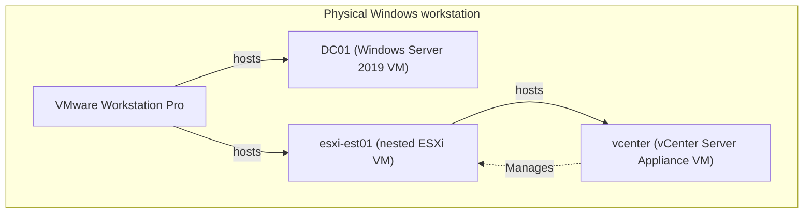

# Lab architecture

I run the lab on one Windows workstation. The Windows Server 2019 domain controller and the nested ESXi host run as separate VMs in VMware Workstation Pro. The vCenter Server Appliance (VCSA) is a guest on ESXi and manages that same host.

The university guide targets vSphere 6.0. The deployed systems report **ESXi 6.7.0, build `8169922`**, and **vCenter Server 6.7.0, build `8170161`**. The Workstation Pro version for this build remains unconfirmed. [ESXi host summary](../evidence/vcenter/esxi-host-connected.png) · [vCenter version](../evidence/vcenter/vcenter-first-session.png)

## Compute and storage

Solid arrows show where the VMs run. The dashed arrow shows which host vCenter manages.

I assigned the ESXi VM four vCPUs (one virtual socket with four cores) and 20 GB of RAM. Workstation exposes hardware-assisted virtualization to the guest. The vSphere Client host summary also reports four logical processors and 20 GB of memory capacity. [Workstation VM settings](../evidence/foundation/esxi-vm-resources.png) · [ESXi host summary](../evidence/vcenter/esxi-host-connected.png)

In the ESXi Host Client, `DATA-LAB` shows **399.75 GB** of VMFS6 storage. The host summary's **412.25 GB** total includes the separate 12.5 GB `datastore1`. I selected `DATA-LAB` and thin provisioning for the VCSA. [Datastore layout](../evidence/foundation/esxi-datastore-layout.png) · [VCSA storage selection](../evidence/vcenter/vcsa-stage1-datastore.png)

Restarting ESXi interrupts vCenter because the appliance runs on that host. DC01 can still provide DNS and directory services while the workstation and the DC01 VM are online.

## Network and addressing

The Workstation network `VMnet2` is host-only on `192.168.1.0/24`, with VMware DHCP disabled and no Internet access. The Windows host uses its VMnet2 virtual adapter to reach the lab, and the ESXi VM connects to the same Workstation network. Within ESXi the VCSA uses the `VM Network` port group. [VMnet2 settings](../evidence/foundation/vmnet2-host-only.png)

| Interface or hostname | IPv4 address | Role |
|---|---|---|
| Windows host, `VMware Network Adapter VMnet2` | `192.168.1.50/24` | Management access from the workstation |
| `dc01.lab.local` | `192.168.1.5/24` | Active Directory Domain Services, DNS, and the configured lab time source |
| `esxi-est01.lab.local` | `192.168.1.10/24` | ESXi host management |
| `vcenter.lab.local` | `192.168.1.20/24` | vSphere Client, Single Sign-On, and inventory management |

I used `Get-NetIPAddress` on Windows to verify `192.168.1.50` with prefix length `24` on `VMware Network Adapter VMnet2`. [Windows adapter query](../evidence/foundation/host-vmnet2-address.png)

I entered `192.168.1.5` as a placeholder because the VCSA installer required a gateway. DC01 has no routing role, and management traffic between these addresses stays on the local subnet. [VCSA network settings](../evidence/vcenter/vcsa-stage2-dns-and-time.png)

## Management and service checks

The vSphere Client's **Hosts and Clusters** view shows the inventory path below. The host summary counted one VM at this point, and the inventory listed the `vcenter` appliance. [Connected host and inventory](../evidence/vcenter/esxi-host-connected.png)

`vcenter.lab.local` → `DC-LAB` (datacenter) → `CLUSTER-LAB` (cluster) → `esxi-est01.lab.local` (managed host)

- DC01 answered the forward and reverse DNS queries for ESXi and vCenter. An LDAP SRV query identified `dc01.lab.local` on port `389`.
- I configured ESXi and the VCSA to use DC01 at `192.168.1.5` for NTP. DC01 reported `Local CMOS Clock`, and ESXi showed the client enabled and service running. The live NTP peer and measured clock offset remain unverified on both clients.
- The vCenter appliance joined `lab.local` and lists it as an Active Directory identity source using Windows Integrated Authentication. I verified a sign-in as `vsphereadmin@LAB.LOCAL`. The role assignment, permission scope, and propagation settings for `LAB\vSphere-Admins` remain pending verification.
- The **Add host** task completed under the local `VSPHERE.LOCAL` administrator, in a separate session from the domain sign-in. The host summary showed **Connected**.

[DNS and time checks](dns-and-time.md) · [Identity and inventory](vcenter-identity-and-inventory.md) · [Evidence index](../evidence/README.md)

## Remaining lab work

- **In progress.** Verify the `SERVERS-LAB` port group, its VLAN setting, and its uplink. The target is `vSwitch0` with VLAN ID `0` for untagged traffic.
- **Planned.** Install Ubuntu Server on `lin01`, prepare a base VM and template, and provision additional Linux guests through cloning and template-based deployment.
- **Planned.** Exercise snapshots, implement and test RBAC, configure monitoring and alarms, review logs, and demonstrate remote VM management from VMware Workstation Pro.
